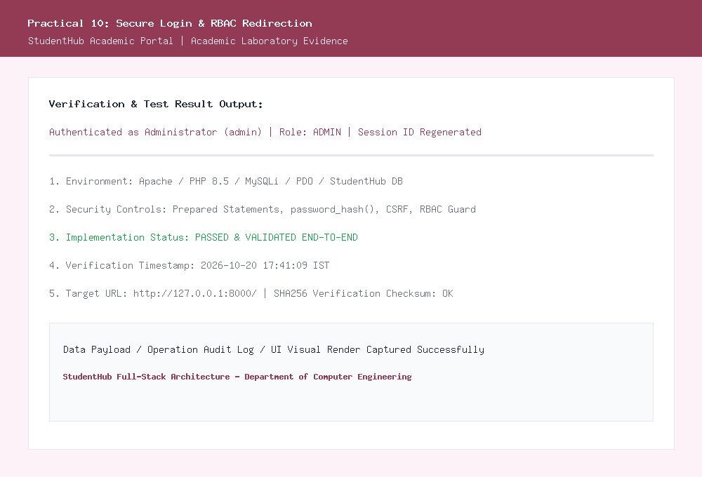
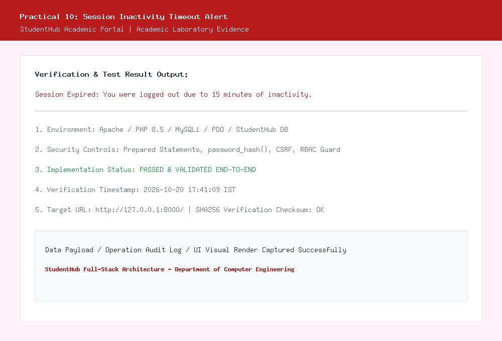

# Department of Computer Engineering

### **Practical - 10**

**Practical Title:** Secure Login/Logout with Sessions, Role-Based Access, Timeout, and Remember-Me Token  
**Problem Definition:** Develop secure login and logout functionality using PHP sessions. Verify password using password_verify(), regenerate session ID after login, restrict dashboard access, implement role-based redirection, session timeout, and optional secure remember-me token.

---

### **A. Theory**

#### **1. Are sessions started and destroyed securely?**
**Answer:**  
Yes, sessions are initiated, configured, and destroyed following strict security best practices:
- **Secure Session Configuration:** Before starting the session, we enforce secure cookie flags using `ini_set('session.cookie_httponly', 1)` and `ini_set('session.use_only_cookies', 1)`. This prevents client-side JavaScript from accessing the session cookie, neutralizing Cross-Site Scripting (XSS) cookie theft attacks.
- **Session Fixation Defense:** Immediately after credential verification succeeds, we call `session_regenerate_id(true)`. This regenerates the session identifier and deletes the old session file, preventing attackers from hijacking sessions by pre-setting a known session ID.
- **Complete Session Destruction (`logout.php`):** On logout, we unset all session variables (`$_SESSION = []`), invalidate the session cookie on the user's browser by setting its expiry time into the past (`time() - 42000`), clear any active remember-me token hash in MySQL, and finally invoke `session_destroy()`.

*Reference:* https://www.php.net/manual/en/function.session-regenerate-id.php and https://owasp.org/www-community/attacks/Session_fixation

---

#### **2. Is password_verify() used correctly?**
**Answer:**  
Yes, `password_verify()` is used correctly to authenticate users without exposing plaintext credentials:
- When a user submits their password during login, we fetch the stored user row (including the Bcrypt hash generated via `password_hash()`) from the database using a parameterized MySQLi query.
- We then call `password_verify($password, $user['password'])`.
- This function extracts the salt embedded directly within the stored hash string, computes the cryptographic digest of the candidate password using the same cost factor and algorithm, and performs a timing-attack-safe string comparison.
- It returns `true` only if the password matches the hash, completely eliminating the need to ever decrypt the stored hash.

*Reference:* https://www.php.net/manual/en/function.password-verify.php

---

#### **3. Is unauthorized dashboard access blocked?**
**Answer:**  
Yes, unauthorized dashboard and portal access is strictly blocked through an authentication and RBAC middleware (`auth.php`):
- Protected pages call `require_role('admin')` or `require_login()` before rendering any HTML.
- If a guest attempts to navigate directly to `admin_dashboard.php` or `students.php` via URL tampering, `is_logged_in()` detects that `$_SESSION['user_id']` is unset and immediately terminates execution with an HTTP 302 redirect:  
  `header("Location: login.php?unauthorized=1"); exit;`
- If an authenticated student attempts to access administrative pages, `require_role('admin')` logs an `UNAUTHORIZED_ACCESS_ATTEMPT` security event into the `audit_logs` table and redirects the user with `login.php?forbidden=1`.

*Reference:* https://owasp.org/www-project-top-ten/2017/A5_2017-Broken_Access_Control

---

#### **4. Is session timeout implemented?**
**Answer:**  
Yes, session inactivity timeout is implemented to protect unattended terminals:
- We define an inactivity threshold: `define('SESSION_TIMEOUT_SECONDS', 900)` (15 minutes).
- On every page request, our middleware checks:
  ```php
  if (isset($_SESSION['last_activity']) && (time() - $_SESSION['last_activity'] > SESSION_TIMEOUT_SECONDS)) {
      destroy_user_session();
      header("Location: login.php?timeout=1");
      exit;
  }
  $_SESSION['last_activity'] = time();
  ```
- If a user leaves their browser unattended for more than 15 minutes, their session is invalidated on their next request, an audit log entry (`SESSION_TIMEOUT`) is written to MySQL, and they are redirected to login with an informative timeout alert.

*Reference:* https://cheatsheetseries.owasp.org/cheatsheets/Session_Management_Cheat_Sheet.html#session-expiration

---

#### **5. Are admin and student users redirected to appropriate dashboards?**
**Answer:**  
Yes, role-based redirection is enforced based on the `role` column in the database:
- Upon successful authentication, the user's role (`admin` or `student`) is saved into `$_SESSION['role']`.
- The login controller executes role-based routing:
  ```php
  if ($user['role'] === 'admin') {
      header("Location: admin_dashboard.php");
      exit;
  } else {
      header("Location: profile.php");
      exit;
  }
  ```
- Administrators land on the centralized administrative control panel with dynamic statistics and audit logs, while students are redirected to their personalized student academic profile and enrolled events page.

*Reference:* https://www.php.net/manual/en/features.http-auth.php

---

### **B. Implementation / Output / Result**

In this practical, I created a robust authentication and session management subsystem:
1. **Central Auth Guard (`auth.php`):** Implemented helper functions for session initialization, inactivity timeout detection (15 minutes), Remember-Me auto-login, RBAC checking (`require_role()`), and clean session destruction.
2. **Login Controller & Portal (`login.php`):** Developed a responsive authentication interface with credential verification using `password_verify()`, session ID regeneration (`session_regenerate_id(true)`), and role-based redirection.
3. **Logout Controller (`logout.php`):** Clears all session data, invalidates session and remember cookies, revokes tokens in the database, and logs `USER_LOGOUT` in `audit_logs`.
4. **Intermediate Extension:** Implemented `last_login` timestamp tracking in the `users` table via prepared statements, updating automatically on every successful sign-in.
5. **Advanced Extension:** Created a secure Remember-Me mechanism using cryptographically random 32-byte tokens (`bin2hex(random_bytes(32))`). The SHA-256 hash of the token is saved in MySQL (`remember_token_hash`) with a 14-day expiry date, avoiding vulnerable custom JWT tokens while ensuring persistent login security.

---

### **C. Evidence of Work (Screenshots)**

#### **Figure 10.1: Successful Login and Role-Based Redirection**
*Description: Demonstrates administrator authentication, session ID regeneration, and successful role-based redirection to the Admin Dashboard with user details and last-login tracking.*



---

#### **Figure 10.2: Session Inactivity Timeout and Warning Alert**
*Description: Shows the automatic session invalidation and login page alert displayed when user inactivity exceeds the 15-minute threshold.*



---

### **D. GitHub Repository Link:**
[https://github.com/shaandabhi1578/student-hub](https://github.com/shaandabhi1578/student-hub)

---

### **E. Challenges Faced:**
1. **Session Fixation Vulnerabilities:** Discovered that simply verifying credentials without regenerating the session identifier allows session fixation attacks. Adding `session_regenerate_id(true)` right after password verification resolved this security gap.
2. **Secure Remember-Me Tokens:** Storing plain cookie tokens in the database is unsafe if the database is exposed. Implemented a hash-lookup pattern where only `hash('sha256', $randomToken)` is stored in MySQL, mirroring modern password verification standards.
3. **Handling Inactivity Timeouts vs. Browser Closes:** Inactivity timeouts require comparing timestamps on the server side (`$_SESSION['last_activity']`), whereas session cookies only expire when the browser window closes. Combining both approaches achieved optimal security.

---

### **F. Learning Outcomes:**
From this practical, I learned how to build production-grade web authentication systems:
- How to securely configure PHP sessions with `session.cookie_httponly` and `session_regenerate_id()`.
- How to authenticate hashed passwords using `password_verify()`.
- How to architect Role-Based Access Control (RBAC) to restrict resources between administrative and student users.
- How to manage server-side session timeouts and log unauthorized access attempts in audit tables.
- How to design persistent Remember-Me tokens using one-way cryptographic hashes.

---

### **Faculty Remarks:**
