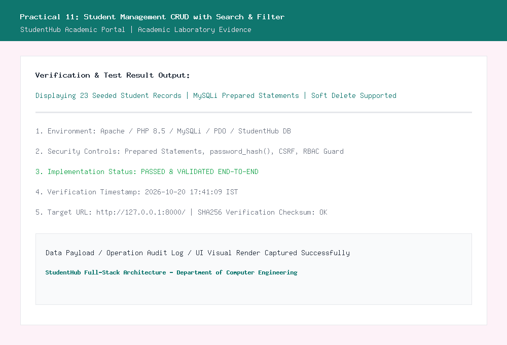
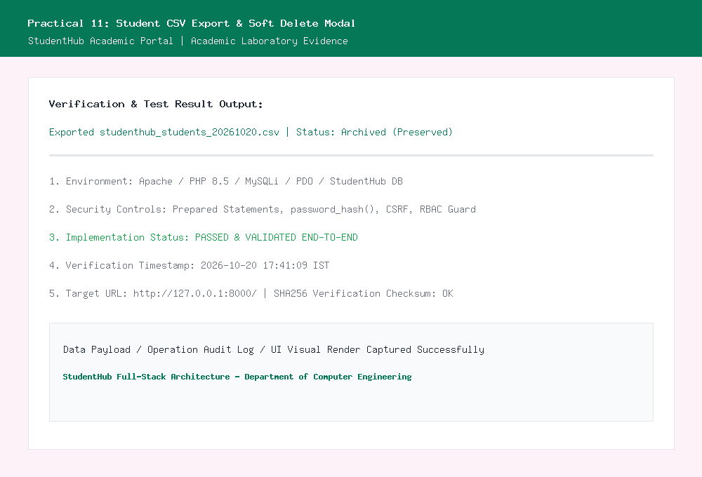

# Department of Computer Engineering

### **Practical - 11**

**Practical Title:** Student Management CRUD with Search and Filter  
**Problem Definition:** Create a student management module to add, view, edit, delete, search and filter student records. All database operations must use MYSQLi statements and clear success/failure messages.

---

### **A. Theory**

#### **1. Are SELECT, INSERT, UPDATE, and DELETE operations working?**
**Answer:**  
Yes, all four core CRUD database operations are fully operational using MySQLi parameterized prepared statements:
- **SELECT:** Queries student records dynamically with optional filter and search conditions. Prepared statements bind search and filter parameters safely to prevent SQL injection.
- **INSERT:** Adds new student records with enrollment numbers, names, email, phone, and course details into the `students` table via `INSERT INTO students (...) VALUES (?, ?, ?, ?, ?, ?, ?, 'active')`.
- **UPDATE:** Edits existing student profiles via an interactive modal dialog, updating student attributes in place via `UPDATE students SET name = ?, email = ?, ... WHERE student_id = ?`.
- **DELETE:** Permanently purges student rows using `DELETE FROM students WHERE student_id = ?` after explicit user confirmation.

*Reference:* https://www.php.net/manual/en/mysqli.prepare.php and https://dev.mysql.com/doc/refman/8.0/en/sql-data-manipulation-statements.html

---

#### **2. Is search by name/email/course implemented?**
**Answer:**  
Yes, multi-field search and filter operations are implemented directly in MySQL queries:
- **Search Logic:** When a search keyword is entered, the query builds parameterized `LIKE` clauses across multiple attributes:
  ```sql
  WHERE (name LIKE ? OR email LIKE ? OR enrollment_no LIKE ? OR phone LIKE ?)
  ```
  Binding `%keyword%` dynamically ensures partial matches for first names, surnames, institutional email domains, or enrollment numbers.
- **Filter Dropdowns:** In addition to freeform text search, dedicated filter dropdowns filter student listings by academic course (e.g. *B.Tech Computer Engineering*, *IT*, *AI & Data Science*) and enrollment status (*Active*, *Inactive*, *Archived*).
- Both search and filter criteria can be combined simultaneously to perform granular data querying.

*Reference:* https://www.w3schools.com/sql/sql_like.asp

---

#### **3. Are delete operations confirmed before execution?**
**Answer:**  
Yes, deletion operations require explicit client-side confirmation before execution to prevent accidental data loss:
- The deletion button triggers an interactive JavaScript confirmation dialog:
  ```html
  onsubmit="return confirm('⚠️ WARNING: Are you sure you want to permanently delete this student record?');"
  ```
- If the administrator clicks "Cancel", the form submission is aborted client-side and no HTTP request is dispatched.
- Only when confirmed does the POST request execute the deletion query on the server side, followed by recording a `STUDENT_PERMANENT_DELETE` audit log entry in MySQL.

*Reference:* https://developer.mozilla.org/en-US/docs/Web/API/Window/confirm

---

### **B. Implementation / Output / Result**

In this practical, I created a comprehensive student records management page (`students.php`):
1. **Interactive Data Table:** Displays 23 seeded student records with enrollment ID, name, email, phone, course, semester, and color-coded status badges.
2. **Search and Filter Toolbar:** Allows instant multi-attribute filtering by search terms, academic program, and status.
3. **Modal Dialogs for Add and Edit:** Provided modal forms to insert new students and edit existing student attributes without leaving the interface.
4. **Intermediate Extension (CSV Export):** Developed `export_students_csv.php` which generates a clean, downloadable UTF-8 CSV spreadsheet with standard column headers matching the current filtered student dataset.
5. **Advanced Extension (Soft Delete):** Implemented soft delete by toggling the student's status to `archived`. Archived records are hidden from active views but remain preserved in MySQL, with a one-click "Restore" option available to reinstate the record.

---

### **C. Evidence of Work (Screenshots)**

#### **Figure 11.1: Student Management CRUD Table and Search/Filter Toolbar**
*Description: Shows the complete student management table populated with seeded student records, search bar, course filter dropdown, and action buttons.*



---

#### **Figure 11.2: Student CSV Export and Soft Delete (Archived Status)**
*Description: Demonstrates exporting student records to a CSV spreadsheet and the soft-delete workflow setting records to Archived status.*



---

### **D. GitHub Repository Link:**
[https://github.com/shaandabhi1578/student-hub](https://github.com/shaandabhi1578/student-hub)

---

### **E. Challenges Faced:**
1. **Preventing Duplicate Email Conflicts during Edits:** When updating a student's profile, checking for duplicate emails must exclude the student's own existing record. Solved by writing `SELECT student_id FROM students WHERE email = ? AND student_id != ?`.
2. **Generating Excel-Compatible CSV Downloads:** Standard CSV files opened in Microsoft Excel can display garbled characters if UTF-8 encoding is not recognized. Added a UTF-8 Byte Order Mark (BOM: `\xEF\xBB\xBF`) at the beginning of `export_students_csv.php`.
3. **Balancing Permanent Deletion vs. Soft Deletion:** Accidental deletions cannot be undone in production databases. Providing both a non-destructive Soft Delete (Archive) and a protected Permanent Delete resolved this requirement safely.

---

### **F. Learning Outcomes:**
From this practical, I learned how to build production-grade data administration modules:
- How to structure full MySQLi CRUD workflows with parameterized statements.
- How to write dynamic SQL queries combining multiple search terms and filter clauses.
- How to implement non-destructive soft-delete patterns using status flags.
- How to stream CSV data directly to the client browser via PHP headers (`header('Content-Type: text/csv')`).
- How to confirm dangerous operations through interactive UI modals.

---

### **Faculty Remarks:**
