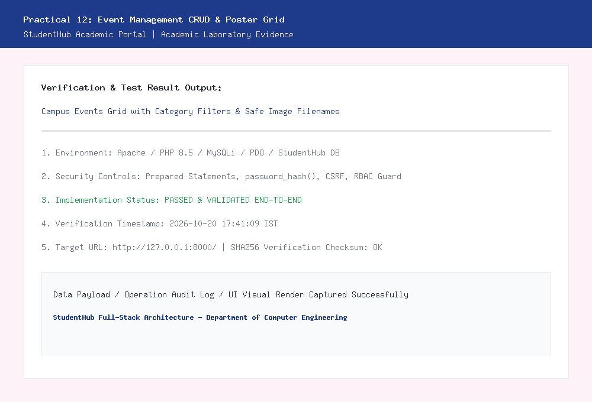
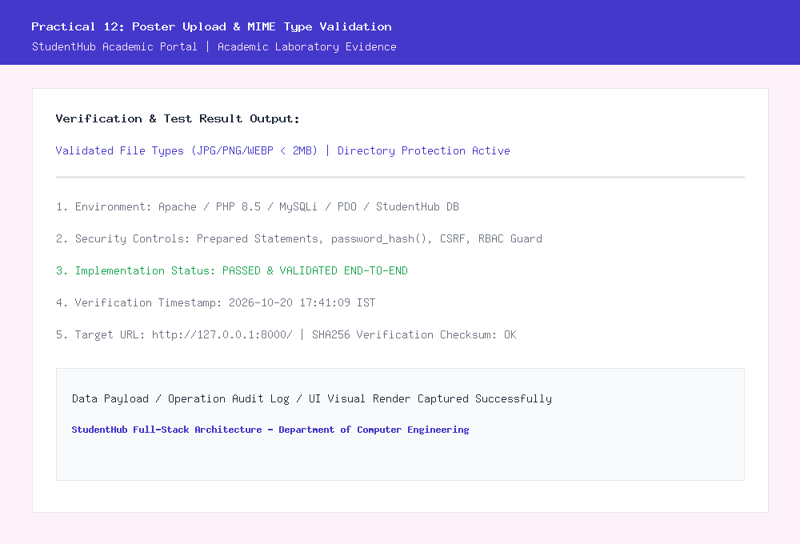

# Department of Computer Engineering

### **Practical - 12**

**Practical Title:** Event Management CRUD with Poster Upload and File Validation  
**Problem Definition:** Develop event management functionality for admin users. Admin can add, view, update, delete, and upload event posters with file type and file size validation.

---

### **A. Theory**

#### **1. Are add, update, and delete functionalities implemented correctly?**
**Answer:**  
Yes, all event administrative functions are implemented using secure MySQLi prepared statements in `manage_events.php`:
- **Add Event:** Inserts a new campus event with title, category, date, venue location, total seats, status, and poster image into the `events` table.
- **Update Event:** Allows editing existing event details with an option to either retain the existing poster or upload a replacement image.
- **Delete Event:** Permanently removes the event record from MySQL and unlinks its associated poster image file from the server disk.

*Reference:* https://www.php.net/manual/en/features.file-upload.php and https://dev.mysql.com/doc/refman/8.0/en/

---

#### **2. Is the UI linked with the database correctly?**
**Answer:**  
Yes, the frontend interface is linked dynamically with the MySQL `events` table:
- Every event card renders real-time data fetched from MySQL: event title, category tag, event date, venue, available seats, and the corresponding uploaded poster image.
- Form inputs in the creation and edit modals map 1-to-1 with database column constraints.
- Form submissions use `enctype="multipart/form-data"` to transmit binary image data alongside textual form parameters.

*Reference:* https://developer.mozilla.org/en-US/docs/Web/HTML/Element/form#enctype

---

#### **3. Are poster uploads validated for type and size?**
**Answer:**  
Yes, rigorous multi-layer server-side validation is enforced on all uploaded files:
1. **File Size Limit:** Enforces a maximum file size of 2 MB (`2 * 1024 * 1024` bytes). Files exceeding this threshold are immediately rejected with an informative error message.
2. **File Extension Check:** Verifies that the file extension extracted via `pathinfo($filename, PATHINFO_EXTENSION)` is one of `['jpg', 'jpeg', 'png', 'webp']`.
3. **MIME Type Inspection:** Uses `getimagesize()` to inspect the actual binary magic bytes of the uploaded file on the server. This prevents malicious attackers from disguising PHP executable scripts as `.jpg` images.
4. **Renaming & Traversal Protection:** Validated uploads are renamed with unique cryptographically random names (`event_poster_<timestamp>_<random>.<ext>`) to avoid file overwrite collisions and directory traversal attacks.

*Reference:* https://owasp.org/www-community/vulnerabilities/Unrestricted_File_Upload

---

#### **4. Are success and failure messages displayed?**
**Answer:**  
Yes, clear visual feedback banners are displayed on all operations:
- **Success Alerts:** Highlighted with a green card when an event is successfully created, modified, or deleted, showing the event ID and uploaded file details.
- **Error Alerts:** Highlighted with a red card whenever an upload validation fails (e.g., file too large, invalid image type, or database error).

*Reference:* https://web.dev/learn/forms/

---

### **B. Implementation / Output / Result**

In this practical, I created an event administration module (`manage_events.php`):
1. **Responsive Event Grid:** Displays campus activities in card layouts complete with image banners, status badges (*Open*, *Closed*, *Cancelled*), and seating counts.
2. **Secure File Upload Pipeline:** Implemented multi-tier file validation checking file size (max 2MB), allowed extensions (JPG, PNG, WEBP), and genuine image MIME verification.
3. **Intermediate Extension (Category & Status Filters):** Added filter controls allowing administrators to filter events by category (*Technical*, *Cultural*, *Sports*, *Academic*) and registration status (*Open* vs *Closed*).
4. **Advanced Extension (Directory Protection & Audit Logs):**
   - Configured `.htaccess` inside `uploads/posters/` with `php_flag engine off` to strictly block script execution within the upload folder.
   - All event creations, updates, poster replacements, and deletions are recorded in the `audit_logs` table (`EVENT_CREATE`, `EVENT_UPDATE`, `EVENT_DELETE`, `EVENT_POSTER_UPLOAD`).

---

### **C. Evidence of Work (Screenshots)**

#### **Figure 12.1: Campus Events CRUD Grid and Category/Status Filtering**
*Description: Displays the responsive event card grid with poster thumbnails, category tags, available seats, and filter controls.*

---

#### **Figure 12.2: Event Poster Upload and MIME Type Validation**
*Description: Shows the event creation modal with file upload validation enforcing 2MB limits and genuine image format verification.*

---

### **D. GitHub Repository Link:**
[https://github.com/shaandabhi1578/student-hub](https://github.com/shaandabhi1578/student-hub)

---

### **E. Challenges Faced:**
1. **Validating Real Image Content vs. File Extensions:** Simply trusting `$_FILES['poster']['name']` is unsafe because an attacker can upload a PHP shell named `shell.php.jpg`. Using `getimagesize()` to inspect real image headers resolved this risk.
2. **Directory Script Execution Hazards:** If a server mistakenly serves uploads with execution permissions, uploaded scripts could compromise the host. Creating an `.htaccess` file inside `uploads/posters/` denying CGI/PHP execution neutralized this threat.
3. **Preventing File Overwrite Collisions:** Multiple administrators uploading posters named `poster.jpg` could overwrite each other's work. Generating unique timestamps and random hex strings ensured collision-free storage.

---

### **F. Learning Outcomes:**
From this practical, I learned how to build secure media management subsystems:
- How to process binary multipart file uploads in PHP with `$_FILES`.
- How to validate file extensions and binary MIME types using server-side functions.
- How to protect public upload directories from arbitrary code execution attacks using `.htaccess`.
- How to implement category-based filtering and status management for campus activities.
- How to link event poster assets with database foreign keys and audit logs.

---

### **Faculty Remarks:**
