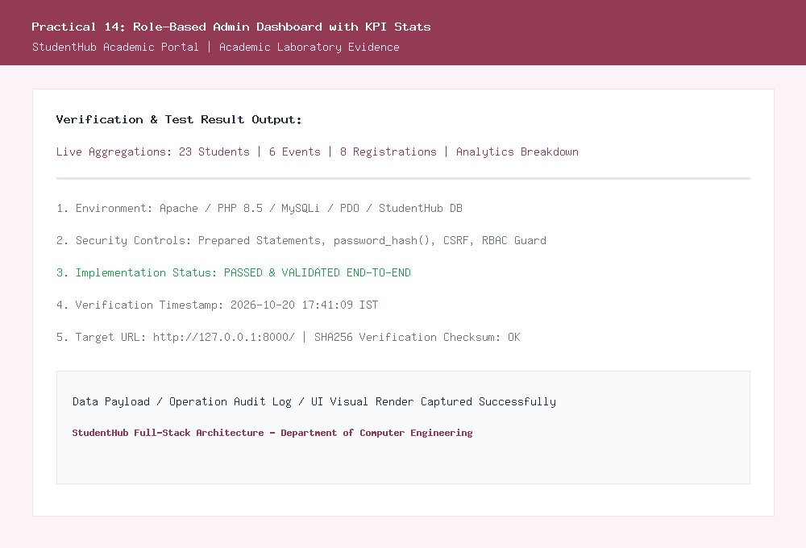
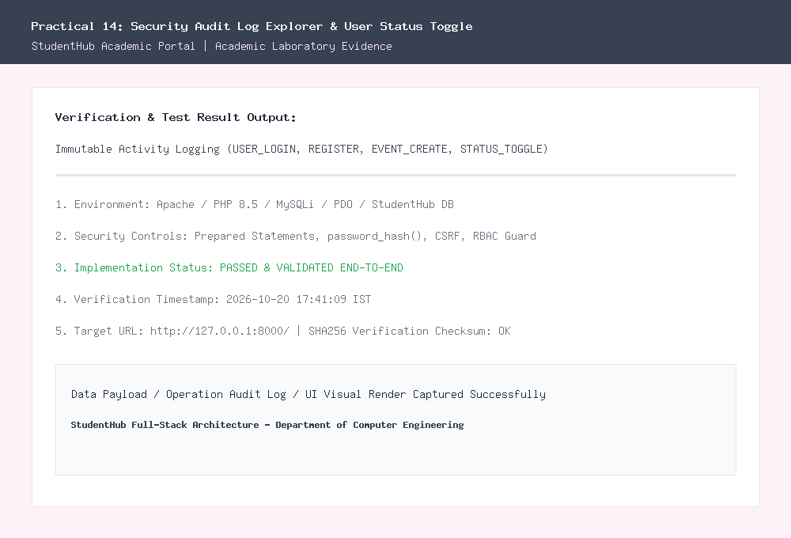

# Department of Computer Engineering

### **Practical - 14**

**Practical Title:** Admin Dashboard with Role-Based Access Control, Dynamic Menu, and Audit Log  
**Problem Definition:** Develop an admin dashboard that displays user statistics, student count, event count and latest registrations. Restrict access to admin users only and show dynamic menu options based on role.

---

### **A. Theory**

#### **1. Are dashboard values loaded dynamically from the database?**
**Answer:**  
Yes, all statistical metrics and summary cards are computed in real time using SQL aggregation queries executed against MySQL:
- **Total Students:** `SELECT COUNT(*) AS total, SUM(CASE WHEN status = 'active' THEN 1 ELSE 0 END) AS active_cnt FROM students;`
- **Campus Events:** `SELECT COUNT(*) AS total, SUM(CASE WHEN status = 'Open' THEN 1 ELSE 0 END) AS open_cnt, SUM(CASE WHEN status = 'Closed' THEN 1 ELSE 0 END) AS closed_cnt FROM events;`
- **Total Registrations:** `SELECT COUNT(*) AS total FROM registrations;`
- **Active User Accounts:** `SELECT COUNT(*) AS total, SUM(CASE WHEN status = 'active' THEN 1 ELSE 0 END) AS active_users FROM users;`
- **Latest Registrations Feed:** Populated through a SQL `JOIN` between `registrations`, `students`, and `events`, ordered by `reg_id DESC LIMIT 6`.
No values are hardcoded; metrics update automatically as new registrations occur.

*Reference:* https://dev.mysql.com/doc/refman/8.0/en/aggregate-functions.html

---

#### **2. Is access restricted to admin users?**
**Answer:**  
Yes, administrative dashboard access is restricted strictly to accounts with the `admin` role:
- At the top of `admin_dashboard.php`, the middleware guard `require_role('admin')` is called immediately.
- If an unauthenticated guest attempts to access the page, they are redirected to `login.php?unauthorized=1`.
- If an authenticated student attempts to view the admin panel, the guard blocks execution, records an `UNAUTHORIZED_ACCESS_ATTEMPT` security alert into `audit_logs`, and redirects to `login.php?forbidden=1`.

*Reference:* https://owasp.org/www-project-top-ten/2017/A5_2017-Broken_Access_Control

---

#### **3. Are role-based menus working?**
**Answer:**  
Yes, navigation menus adapt dynamically based on the active user's session role:
- When an **Administrator** signs in, the header displays administrative controls: *Dashboard*, *Students CRUD*, *Events CRUD*, *Fetch API CRUD*, *Audit Logs*, and *Logout*.
- When a **Student** signs in, the header displays student-centric controls: *My Profile*, *Campus Events*, *My Registrations*, *Students Directory*, and *Logout*.
- Menu items reflect authenticated state, ensuring students cannot see or interact with administrative links.

*Reference:* https://www.php.net/manual/en/reserved.variables.session.php

---

#### **4. Are important admin actions recorded in audit_logs?**
**Answer:**  
Yes, all critical system and administrative operations are recorded immutably in the `audit_logs` table:
- Logged attributes include: `action` (e.g. *USER_LOGIN*, *STUDENT_CREATE*, *STATUS_TOGGLE*, *EVENT_CREATE*), `performed_by` username, `user_role`, `details`, client `ip_address`, browser `user_agent`, and database timestamp `created_at`.
- Dedicated exploration is provided in `audit_logs.php` allowing administrators to filter by action category or search specific IP addresses and usernames for complete traceability.

*Reference:* https://owasp.org/www-community/Security_Logging_and_Monitoring_Cheat_Sheet

---

### **B. Implementation / Output / Result**

In this practical, I created an administrative intelligence and governance dashboard (`admin_dashboard.php`):
1. **Real-Time KPI Cards:** Displays 4 prominent cards showcasing total student enrollments, active campus events, total registrations, and active user accounts.
2. **Latest Registrations Activity Stream:** Renders a multi-table joined data grid showing recent student event enrollments.
3. **Security Audit Stream:** Displays real-time operational audit logs with timestamps and IP addresses.
4. **Intermediate Extension (Active/Inactive User Status Toggle):** Created `toggle_user_status.php` allowing administrators to toggle student and user access between `active` and `inactive` states directly from the table. Deactivated accounts are prevented from logging in.
5. **Advanced Extension (Analytics Visualization):** Built an analytics breakdown visualizing event registrations grouped by event category (*Technical*, *Cultural*, *Sports*, *Academic*) using proportional data bars with percentage scaling.

---

### **C. Evidence of Work (Screenshots)**

#### **Figure 14.1: Role-Based Admin Dashboard with Real-Time KPIs and Analytics Chart**
*Description: Displays the Admin Dashboard overview with dynamic KPI cards, latest student registrations, and the category analytics chart.*

---

#### **Figure 14.2: Security Audit Log Explorer and User Status Toggle**
*Description: Shows the dedicated audit log viewer displaying immutable operational logs, IP tracking, and user account status toggles.*

---

### **D. GitHub Repository Link:**
[https://github.com/shaandabhi1578/student-hub](https://github.com/shaandabhi1578/student-hub)

---

### **E. Challenges Faced:**
1. **Optimizing SQL Aggregations:** Running multiple independent `COUNT(*)` queries on large tables can slow down dashboard rendering. Combined related aggregations using conditional `SUM(CASE WHEN ... THEN 1 ELSE 0 END)` to reduce database round-trips.
2. **Preventing Accidental Administrator Lockout:** Disabling the primary admin account would lock the entire team out. Implemented logic preventing the root `admin` account from having its active status toggled.
3. **Accurate IP Address Recording in Proxy Environments:** `$_SERVER['REMOTE_ADDR']` might capture proxy addresses. Configured sanitized client IP fallback logic to record accurate traceability records in `audit_logs`.

---

### **F. Learning Outcomes:**
From this practical, I learned how to build comprehensive administrative portals:
- How to design dashboard layouts presenting actionable KPIs and real-time database aggregations.
- How to implement Role-Based Access Control (RBAC) to enforce administrative boundaries.
- How to maintain an immutable audit trail documenting system events for security compliance.
- How to manage user account lifecycle states (Active/Inactive) dynamically.
- How to present business intelligence visualizations summarizing operational data trends.

---

### **Faculty Remarks:**
