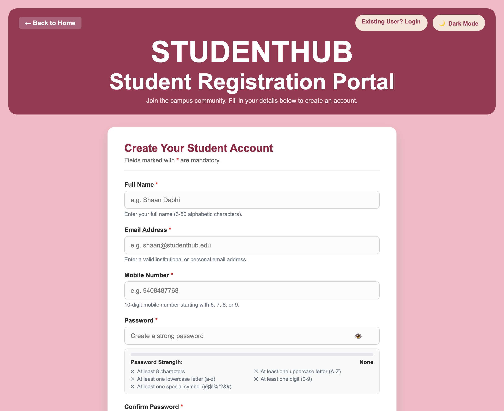
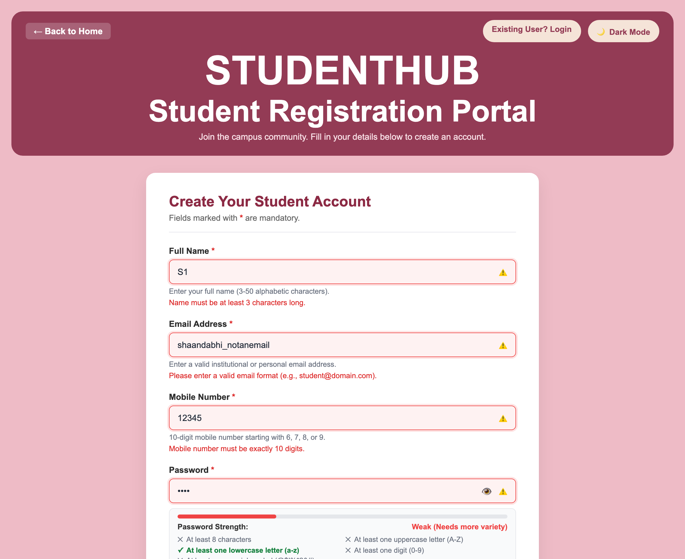
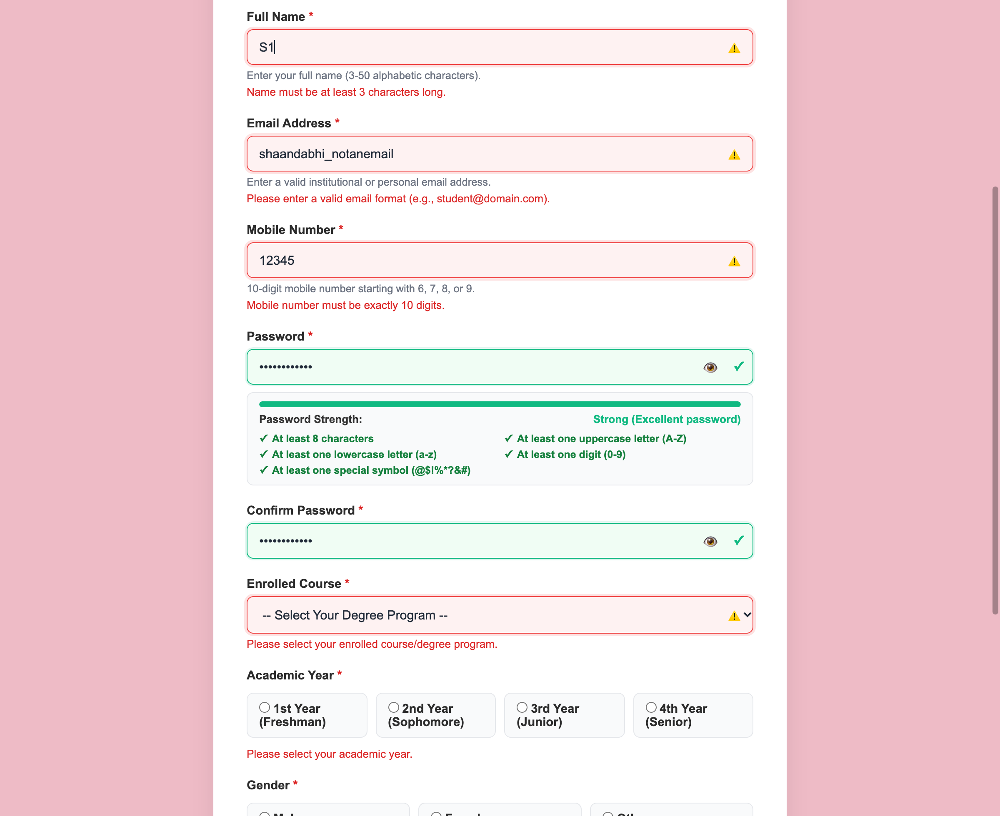
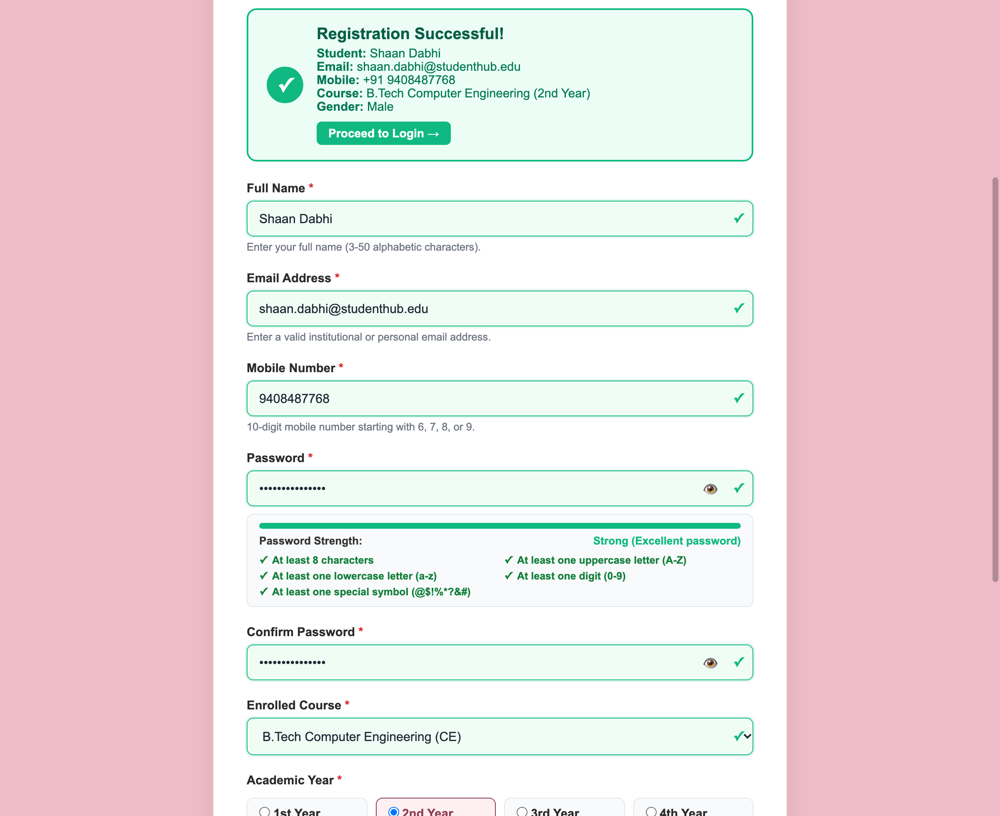
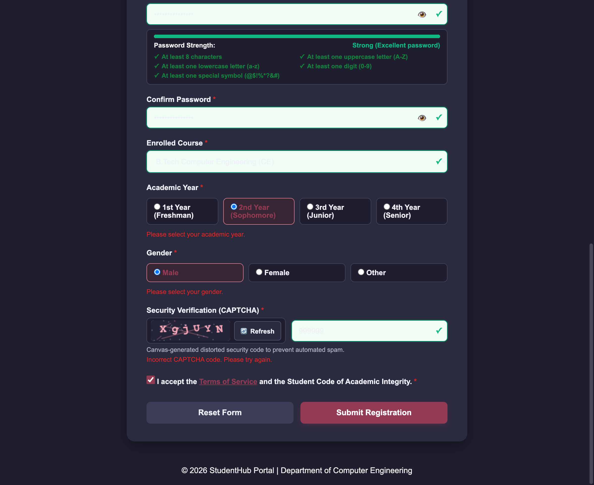

# Department of Computer Engineering

### **Practical - 5**

**Practical Title:** Registration Form with Frontend Validation and User-Friendly Error Handling  
**Problem Definition:** Create a student registration form with HTML5 input types and JavaScript validation for name, email, mobile number, password, confirm password, course, year, gender, and terms acceptance. Use Regular Expression for validations.

---

### **A. Theory**

#### **1. Are correct input types and attributes used?**
**Answer:**  
Yes, suitable HTML5 input types and attributes are used for all fields:
- type="text" is used for Full Name with minlength and maxlength attributes to ensure proper length.
- type="email" is used for Email Address to open email-specific keyboards on phones and check standard format.
- type="tel" is used for Mobile Number to show number keypad on mobile devices and restrict input length to 10 digits.
- type="password" is used for Password and Confirm Password to hide characters on screen, along with an eye icon toggle button to show or hide the password.
- select dropdown is used for Course to let students pick from available degree programs.
- type="radio" inside fieldset is used for Academic Year and Gender where only one option should be chosen.
- type="checkbox" is used for Terms Acceptance to ensure the student accepts college rules before submitting.
- novalidate attribute is added to the form tag so custom JavaScript validation handles all checks and displays styled error messages.

*Reference:* https://developer.mozilla.org/en-US/docs/Web/HTML/Element/input and https://www.w3schools.com/html/html_forms.asp

---

#### **2. Are validation errors displayed near the relevant fields?**
**Answer:**  
Yes, validation errors are placed right below each input field:
- Each field has an error message span tag directly underneath it. When the input is invalid, red error text explains what needs to be fixed.
- The input border turns red when invalid, and turns green with a checkmark once the input is valid.
- We use input and change event listeners to give real-time feedback as the user types, instead of waiting only for form submission.
- When the form is submitted with errors, the page automatically moves focus to the first invalid field so the student can fix it right away.

*Reference:* https://www.w3schools.com/js/js_validation.asp and https://web.dev/learn/forms/

---

#### **3. Is password strength checked?**
**Answer:**  
Yes, password strength is checked dynamically as the user types:
- A JavaScript function checks five conditions: at least 8 characters, at least one uppercase letter, at least one lowercase letter, at least one digit, and at least one special symbol.
- A visual progress meter updates between Weak (red), Medium (orange), and Strong (green) based on how many criteria are met.
- A simple checklist below the password field turns from a cross to a green checkmark when each rule is fulfilled.
- A regular expression is used on form submit to ensure only passwords meeting all rules can be submitted.

*Reference:* https://developer.mozilla.org/en-US/docs/Web/JavaScript/Guide/Regular_expressions

---

#### **4. Is the form accessible using keyboard and screen-reader-friendly labels?**
**Answer:**  
Yes, the form is designed to be accessible for all users:
- Every input element has a matching label connected using the for and id attributes. Clicking a label focuses the input field.
- Radio buttons for Academic Year and Gender are wrapped inside fieldset and legend tags so screen readers read the section name before reading the options.
- The aria-describedby attribute connects input fields to their error messages so screen readers announce the error when an invalid input is selected.
- All controls including inputs, buttons, checkboxes, and the CAPTCHA refresh button can be navigated using the Tab key on the keyboard.

*Reference:* https://web.dev/learn/accessibility/forms/

---

### **B. Implementation / Output / Result**

In this practical, I created a student registration form page (register.html, register.css, register.js) with client-side validation:
- Name validation: checks that name is at least 3 characters and contains only letters and spaces using regex /^[A-Za-z\s]{3,50}$/.
- Email validation: checks valid email pattern using regex /^[a-zA-Z0-9._%+-]+@[a-zA-Z0-9.-]+\.[a-zA-Z]{2,}$/.
- Mobile validation: checks 10 digits starting with 6, 7, 8, or 9 using regex /^[6-9]\d{9}$/ and removes non-digit characters during typing.
- Password and confirm password: checks password complexity rules and ensures both fields match.
- Course, Year, and Gender: ensures mandatory selections are made before submitting.
- Canvas CAPTCHA: draws a random 6-character code with noise lines and rotation on an HTML5 canvas element with a refresh button.
- Terms checkbox: verifies that the student checked the terms acceptance box.
- Real-time feedback: updates borders to green or red and shows helpful error messages below fields.

---

### **C. Evidence of Work (Screenshots)**

#### **Figure 5.1: Initial Student Registration Form UI with Canvas CAPTCHA**
*Description: Displays the initial clean student registration form layout with accessible input fields, password strength indicator, and canvas CAPTCHA.*

---

#### **Figure 5.2: Real-time Inline Validation Errors and Invalid Input Handling**
*Description: Shows red error borders, warning icons, and inline error messages displayed when invalid details are entered.*

---

#### **Figure 5.3: Password Strength Indicator and Rules Checklist**
*Description: Illustrates real-time password strength meter showing strong rating with all rule checkmarks satisfied.*

---

#### **Figure 5.4: Successful Form Validation and Submission Banner**
*Description: Shows all form inputs verified with green borders and checkmarks, with the green confirmation banner displaying submitted student details.*

---

#### **Figure 5.5: Canvas CAPTCHA and Dark Mode Theme Integration**
*Description: Displays the canvas-based distorted security CAPTCHA generator and dark theme mode.*

---

### **D. GitHub Repository Link:**
[https://github.com/shaandabhi1578/student-hub](https://github.com/shaandabhi1578/student-hub)

---

### **E. Challenges Faced:**
1. Allowing spaces in student names: A basic regex without spaces rejected full names. I updated the regex to include spaces (`\s`) and used `trim()` so names with spaces work correctly.
2. Checking passwords in real time: Updating the strength meter on every keystroke was needed so users know which rule is missing before clicking submit.
3. Keeping CAPTCHA readable: Random noise lines and character rotation needed to be adjusted so characters remained readable while still preventing automated bots.
4. Ensuring keyboard navigation: Making sure that all buttons and radio buttons could be focused and activated using Tab, Space, and Enter keys.

---

### **F. Learning Outcomes:**
From this practical, I learned how to create accessible web forms with client-side JavaScript validation:
- How to choose appropriate HTML5 input types for different kinds of data.
- How to write and use regular expressions for names, emails, and phone numbers.
- How to build a password strength meter that gives live visual feedback.
- How to show error messages near each input without cluttering the screen.
- How to generate a simple visual CAPTCHA using the HTML5 Canvas API.

---

### **Faculty Remarks:**
