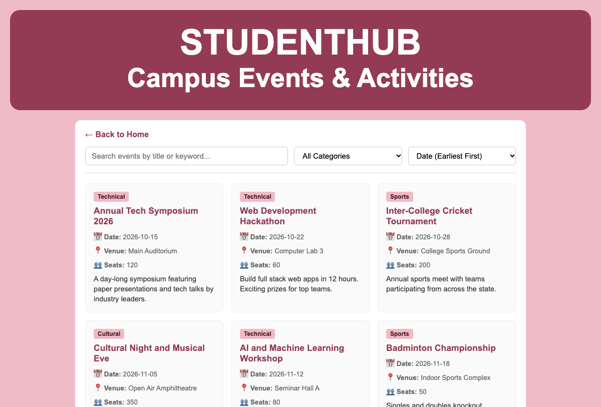
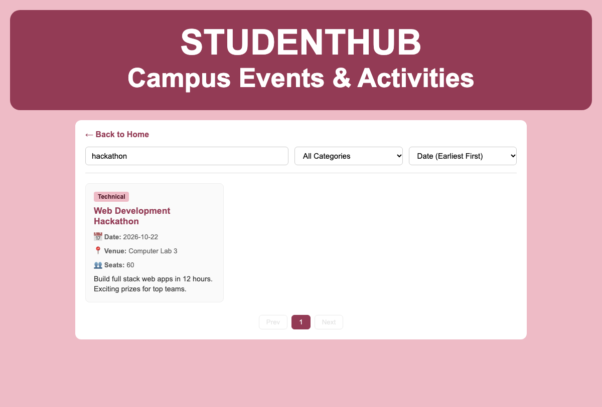
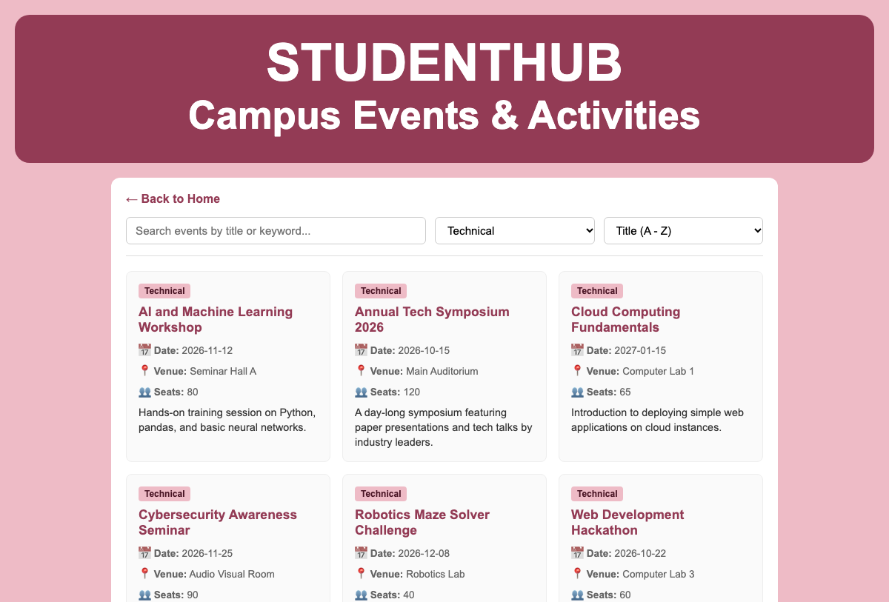

# Department of Computer Engineering

### **Practical - 6**

**Practical Title:** Rendering External JSON Data using Fetch API, Search and Filter  
**Problem Definition:** Display event lists, student profiles, notices, or FAQs from external JSON files using Fetch API. Implement dynamic rendering, search, filter, sorting, and pagination.

---

### **A. Theory**

#### **1. How is JSON fetched, parsed, and rendered?**
**Answer:**  
JSON is fetched in JavaScript using the browser's built-in `fetch()` function. `fetch()` sends an asynchronous HTTP GET request to the path of the JSON file (`events.json`). Because fetching takes time, `fetch()` returns a Promise. 

When the server responds, we call `response.json()` to parse the raw JSON text into a usable JavaScript array of objects. After parsing, we loop through the array using `map()` or `forEach()` and build HTML card elements with template literals. Finally, we place the generated HTML into the webpage container using `innerHTML`.

*Reference:* https://developer.mozilla.org/en-US/docs/Web/API/Fetch_API/Using_Fetch and https://www.w3schools.com/js/js_api_fetch.asp

---

#### **2. Which array methods are used for search, filter, sort, and pagination?**
**Answer:**  
We use standard JavaScript array methods to manipulate the data:
- `filter()`: Used for searching and category filtering. For search, we check if the event title, description, or venue contains the query string using `toLowerCase().includes()`. For category, we match `item.category === selectedCategory`.
- `sort()`: Used to arrange items in order. For dates, we compare `new Date(a.date) - new Date(b.date)`. For titles, we compare strings using `a.title.localeCompare(b.title)`.
- `slice()`: Used for pagination. We calculate the start index as `(currentPage - 1) * itemsPerPage` and the end index as `startIndex + itemsPerPage`. `array.slice(startIndex, endIndex)` returns only the items for the current page.
- `map()`: Used to transform each event object into an HTML string for display on the screen.

*Reference:* https://developer.mozilla.org/en-US/docs/Web/JavaScript/Reference/Global_Objects/Array

---

#### **3. How are loading and error states handled?**
**Answer:**  
Loading and error states are handled by showing and hiding simple message elements in the DOM:
- Before starting the fetch request, we display a loading message ("Loading events from server...").
- When the data arrives successfully, we hide the loading message and render the event cards.
- If the fetch request fails (for example, due to a broken file path or network issue), the `.catch()` block catches the error, hides the loading text, and shows a user-friendly error message in red text ("Failed to load events. Please try again later.").
- If a search produces no matching items, we show an empty state message ("No events found matching your search criteria.").

*Reference:* https://developer.mozilla.org/en-US/docs/Web/JavaScript/Guide/Using_promises

---

#### **4. How is modularity maintained in JavaScript files?**
**Answer:**  
Modularity is maintained by keeping data and logic separate, and dividing tasks into small, dedicated functions:
- The data is kept in an external file (`events.json`), so it can be updated without changing JavaScript code.
- Functions are separated by responsibility: `loadEvents()` handles fetching and error handling, `getProcessedEvents()` handles searching, filtering, and sorting, and `render()` handles updating the HTML and pagination controls.
- Keeping functions small makes the code easy to read, debug, and reuse across the StudentHub portal.

*Reference:* https://javascript.info/modules-intro

---

### **B. Implementation / Output / Result**

In this practical, I created an interactive Campus Events page (`events.html`, `events.js`) powered by an external dataset (`events.json`):
- Created `events.json` with 16 event records containing id, title, category, date, venue, seats, and description.
- Used `fetch("events.json")` to asynchronously retrieve the event records.
- Added a search input box that filters events in real time as the user types.
- Added a category filter dropdown to view events by Technical, Sports, Cultural, Social, or Academic categories.
- Added a sort dropdown to sort events by date or title.
- Implemented client-side pagination displaying 6 events per page with Previous and Next buttons.
- Cached fetched events in `localStorage` so the page can still display events even if the network fails.

---

### **C. Evidence of Work (Screenshots)**

#### **Figure 6.1: Campus Events Page with Fetched JSON Data and Pagination**
*Description: Shows the events page displaying the first page of 6 event cards fetched from events.json, with category tags, dates, venues, and pagination buttons.*

---

#### **Figure 6.2: Real-time Keyword Search Filter**
*Description: Shows search results when typing "hackathon" into the search bar, filtering the cards to show only matching events.*

---

#### **Figure 6.3: Category Filter and Title Sorting**
*Description: Shows events filtered by the "Technical" category and sorted alphabetically by title from A to Z.*

---

### **D. GitHub Repository Link:**
[https://github.com/shaandabhi1578/student-hub](https://github.com/shaandabhi1578/student-hub)

---

### **E. Challenges Faced:**
1. Handling local file fetch restrictions: Running `fetch()` directly from `file://` was blocked by the browser. I solved this by running a simple local development server.
2. Keeping search and category filter combined: Initially, selecting a category reset the search box. I fixed this by combining search, category, and sort in a single function `getProcessedEvents()`.
3. Resetting pagination page on new search: If the user was on page 3 and searched for a word with only 2 results, the screen showed blank. I fixed this by resetting `currentPage = 1` whenever the search query or category filter changes.

---

### **F. Learning Outcomes:**
From this practical, I learned how to work with asynchronous JavaScript and external JSON datasets:
- How to use the `fetch()` API and handle Promises with `.then()` and `.catch()`.
- How to use array methods like `filter()`, `sort()`, `slice()`, and `map()` to process data on the frontend.
- How to display loading and error messages to improve user experience.
- How to build a client-side pagination system.
- How to use `localStorage` to cache data for offline use.

---

### **Faculty Remarks:**
