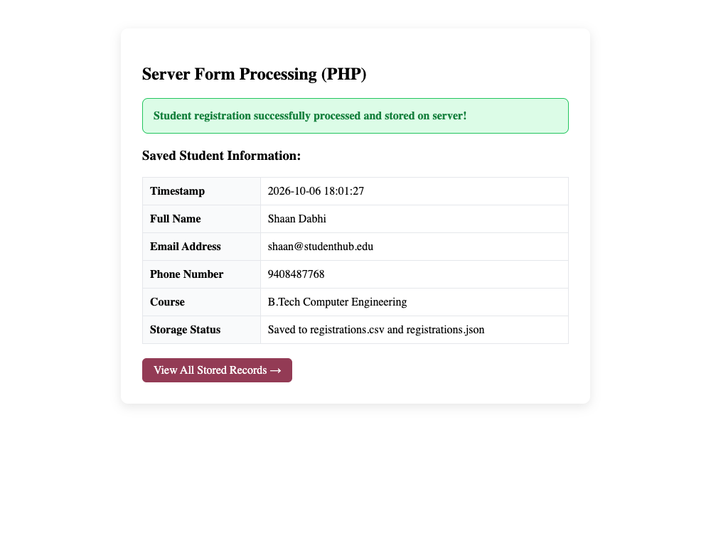
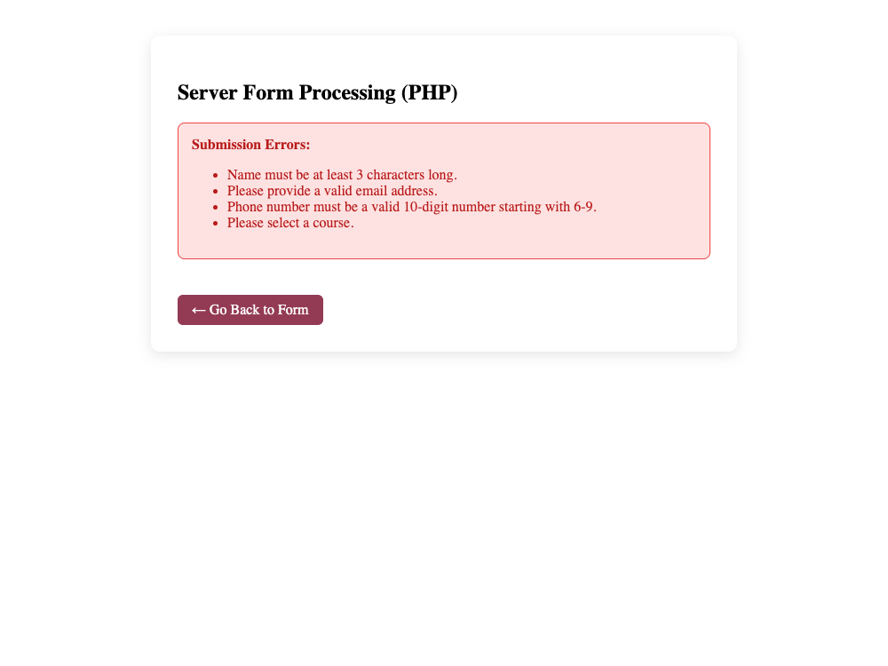
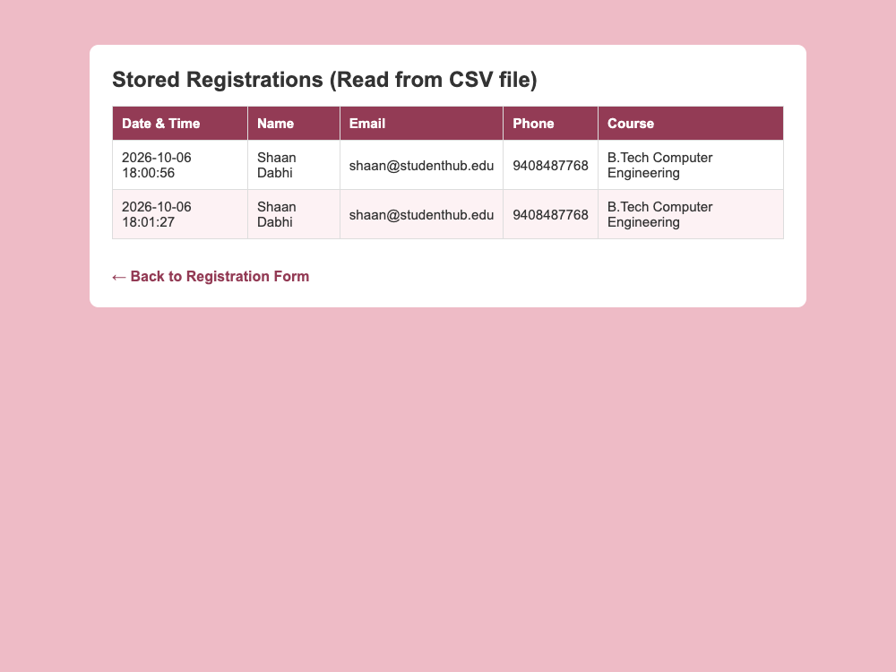

# Department of Computer Engineering

### **Practical - 7**

**Practical Title:** PHP Form Processing with Server-Side Validation and CSV/JSON File Storage  
**Problem Definition:** Process submitted registration/contact form data using PHP. Validate and sanitize inputs on the server side and store records in CSV or JSON file format. Display success/error messages.

---

### **A. Theory**

#### **1. Is the form submitted using POST?**
**Answer:**  
Yes, the form is submitted using the HTTP POST method (`method="POST"`). 

We choose POST instead of GET for several practical reasons:
- With GET, submitted data is visible in the browser URL address bar, which is not suitable for personal details or passwords.
- With POST, the submitted data is sent inside the HTTP request body, keeping it hidden from the URL and browser history.
- GET has a length limit on the URL, whereas POST can send larger amounts of data without getting cut off.
- In PHP, we access the submitted form values using the superglobal array `$_POST`.

*Reference:* https://www.php.net/manual/en/reserved.variables.post.php and https://www.w3schools.com/php/php_forms.asp

---

#### **2. Are inputs validated and sanitized server side?**
**Answer:**  
Yes, all inputs are sanitized and validated on the server using PHP before saving them:
- Sanitization: We use `trim()` to remove extra whitespace from both ends of the text, and `htmlspecialchars()` to convert special characters like `<` and `>` into HTML entities. This prevents Cross-Site Scripting (XSS) attacks.
- Validation: We check each field on the server:
  - Name is checked to make sure it is not empty and has at least 3 characters.
  - Email is verified using `filter_var($email, FILTER_VALIDATE_EMAIL)` to confirm it has a valid email format.
  - Mobile number is checked using `preg_match("/^[6-9][0-9]{9}$/", $phone)` to confirm it has exactly 10 digits starting with 6, 7, 8, or 9.
  - Course selection is checked to ensure an option was chosen.
- Client-side validation in the browser can be bypassed by turning off JavaScript, so server-side validation in PHP is necessary to keep data clean and safe.

*Reference:* https://www.php.net/manual/en/filter.filters.validate.php and https://www.w3schools.com/php/php_form_validation.asp

---

#### **3. Is file writing handled safely?**
**Answer:**  
Yes, file writing is handled safely using proper PHP file handling functions:
- For CSV storage, we use `fopen("registrations.csv", "a")` with append mode (`"a"`). Append mode adds new records to the end of the file without deleting existing data.
- We check if the file handle is valid before writing (`if ($fileHandle !== false)`).
- We use `fputcsv()` to write rows, which handles comma separation, spaces, and quotes properly.
- After writing, we close the file using `fclose($fileHandle)` to prevent file lock issues and save server memory.
- For JSON storage, we read existing records using `file_get_contents()`, decode them with `json_decode()`, append the new record to the PHP array, and write back using `file_put_contents()`.

*Reference:* https://www.php.net/manual/en/function.fputcsv.php and https://www.php.net/manual/en/function.fopen.php

---

#### **4. Are success and error responses displayed clearly?**
**Answer:**  
Yes, clear and user-friendly response messages are displayed:
- If validation fails, PHP collects all errors into an `$errors` array and displays them in a red alert box with a bulleted list, along with a "Go Back" button so the user can correct the mistake.
- If validation succeeds, a green alert box appears showing "Student registration successfully processed and stored on server!", followed by a clean summary table of the submitted details.
- A link to `view_records.php` is provided so users can view the stored records read from the CSV file.

*Reference:* https://www.php.net/manual/en/language.variables.superglobals.php

---

### **B. Implementation / Output / Result**

In this practical, I created a backend form processor (`process_registration.php`) and a record viewer (`view_records.php`):
- Form data is submitted to `process_registration.php` using the POST method.
- Sanitized all inputs using `trim()` and `htmlspecialchars()`.
- Validated name, email, phone number, and course on the server side using PHP.
- Saved valid records into `registrations.csv` using `fopen()` and `fputcsv()`.
- Saved records into `registrations.json` using `file_put_contents()` and `json_encode()`.
- Created `view_records.php` to read the stored CSV file using `fgetcsv()` and display the records in a styled table on the webpage.

---

### **C. Evidence of Work (Screenshots)**

#### **Figure 7.1: Successful Form Processing and Summary Output**
*Description: Displays the green success message and details table after valid registration data is processed and stored on the server.*

---

#### **Figure 7.2: Server-Side Validation Error Handling**
*Description: Displays the red error alert with specific validation error messages when invalid form fields are submitted.*

---

#### **Figure 7.3: Displaying Stored CSV Records on Webpage**
*Description: Shows view_records.php reading the stored student registration records from registrations.csv and displaying them in a table.*

---

### **D. GitHub Repository Link:**
[https://github.com/shaandabhi1578/student-hub](https://github.com/shaandabhi1578/student-hub)

---

### **E. Challenges Faced:**
1. Remembering to use POST instead of GET: Initially, form inputs were visible in the URL. I changed `method="POST"` in the form tag and updated `$_GET` to `$_POST` in PHP.
2. Handling CSV headers: When writing to `registrations.csv` for the first time, the header row needed to be added only once. I solved this by checking `!file_exists($csvFile)` before adding headers.
3. Preventing file permission errors: Ensuring the web server had write permission in the project folder to create and write to CSV and JSON files.

---

### **F. Learning Outcomes:**
From this practical, I learned how server-side form processing works in PHP:
- How to receive form data using `$_POST`.
- How to sanitize inputs with `trim()` and `htmlspecialchars()`, and validate them using `filter_var()` and regular expressions.
- How to open, append, write, and close files safely in PHP using `fopen()`, `fputcsv()`, and `fclose()`.
- How to store and read data in both CSV and JSON file formats.
- How to display meaningful success and error messages back to the user.

---

### **Faculty Remarks:**
