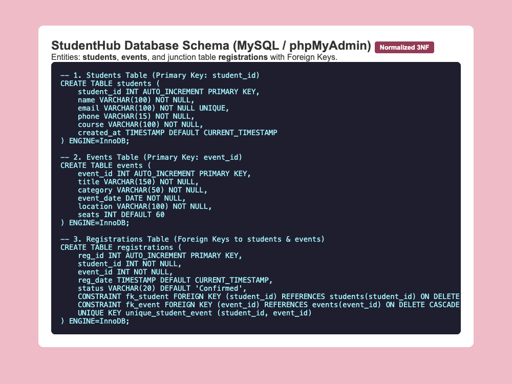
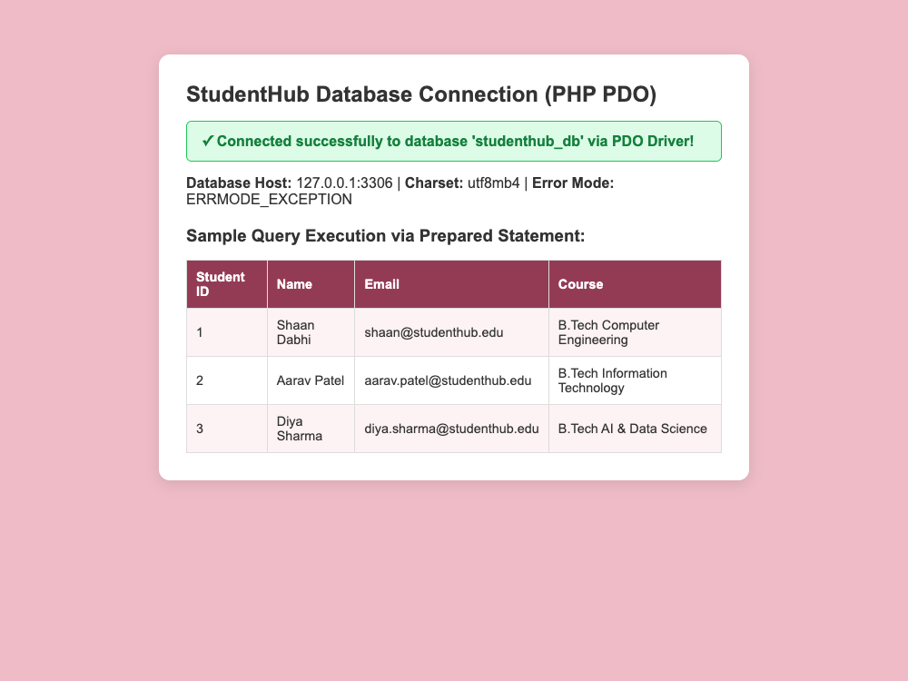

# Department of Computer Engineering

### **Practical - 8**

**Practical Title:** MySQL Schema Design, ER Model, PDO Connectivity, and Prepared Statements  
**Problem Definition:** Design the database for StudentHub with students, events and registrations. Create PHP database connection using MYSQL statements.

---

### **A. Theory**

#### **1. Is the schema normalized properly?**
**Answer:**  
Yes, the database schema is normalized up to Third Normal Form (3NF) to eliminate duplicate data and avoid anomalies:
- First Normal Form (1NF): Every column stores atomic (single) values. For example, student name and contact details are stored in separate individual columns rather than grouped into one.
- Second Normal Form (2NF): All non-key attributes depend completely on the primary key of their table. For instance, student details depend on `student_id`, and event details depend on `event_id`.
- Third Normal Form (3NF): There are no transitive dependencies. Non-key columns do not depend on other non-key columns.
- Separating data into `students`, `events`, and `registrations` ensures that adding a new event does not require creating dummy student rows, and deleting a student does not accidentally delete the event itself.

*Reference:* https://www.geeksforgeeks.org/introduction-of-database-normalization/ and https://dev.mysql.com/doc/refman/8.0/en/

---

#### **2. Are primary keys and foreign keys correctly defined?**
**Answer:**  
Yes, primary keys and foreign keys are defined properly across all three tables:
- Primary Keys:
  - `students` table uses `student_id INT AUTO_INCREMENT PRIMARY KEY` to uniquely identify each student.
  - `events` table uses `event_id INT AUTO_INCREMENT PRIMARY KEY` to uniquely identify each campus event.
  - `registrations` table uses `reg_id INT AUTO_INCREMENT PRIMARY KEY` to uniquely identify each registration record.
- Foreign Keys:
  - In `registrations`, `student_id` is a Foreign Key referencing `students(student_id)`.
  - In `registrations`, `event_id` is a Foreign Key referencing `events(event_id)`.
  - `ON DELETE CASCADE` is set on both foreign keys so that if a student or event is removed, their related registration rows are cleaned up automatically without leaving orphan records.
  - A unique key constraint `UNIQUE KEY (student_id, event_id)` prevents the same student from registering for the same event multiple times.

*Reference:* https://dev.mysql.com/doc/refman/8.0/en/create-table-foreign-keys.html and https://www.w3schools.com/sql/sql_foreignkey.asp

---

#### **3. Is the database connection handled securely?**
**Answer:**  
Yes, the database connection is handled securely using PHP PDO (PHP Data Objects):
- We wrap the `new PDO()` connection in a `try ... catch (PDOException $e)` block. If the database server is down or credentials are wrong, the script catches the error and displays a friendly message instead of crashing or leaking database passwords on the screen.
- We set `PDO::ATTR_ERRMODE => PDO::ERRMODE_EXCEPTION` so SQL errors throw catchable exceptions.
- We set `PDO::ATTR_EMULATE_PREPARES => false` to use real native prepared statements.
- Prepared statements separate SQL query code from user data, which protects the application against SQL Injection attacks.
- We set the character set to `utf8mb4` to support international characters and avoid character encoding vulnerabilities.

*Reference:* https://www.php.net/manual/en/book.pdo.php and https://phpdelusions.net/pdo

---

### **B. Implementation / Output / Result**

In this practical, I designed the StudentHub relational database and established a connection using PHP PDO:
- Designed a normalized schema with 3 tables: `students`, `events`, and the `registrations` junction table.
- Created `studenthub_db.sql` with table definitions, primary keys, foreign key constraints, and sample seed records.
- Created `db.php` using PHP PDO to connect to MySQL on `127.0.0.1:3306`.
- Configured PDO error mode to `ERRMODE_EXCEPTION` and disabled prepared statement emulation for security.
- Tested query execution using a prepared statement (`$stmt->prepare()` and `$stmt->execute()`) to safely fetch student rows.

---

### **C. Evidence of Work (Screenshots)**

#### **Figure 8.1: Normalized MySQL Database Schema Definition (SQL)**
*Description: Shows the SQL definitions for students, events, and registrations tables with primary keys, foreign keys, and ON DELETE CASCADE constraints.*

---

#### **Figure 8.2: PHP PDO Database Connection and Prepared Statement Query Test**
*Description: Displays the database connection status card showing successful PDO connection and sample records fetched using a prepared statement.*

---

### **D. GitHub Repository Link:**
[https://github.com/shaandabhi1578/student-hub](https://github.com/shaandabhi1578/student-hub)

---

### **E. Challenges Faced:**
1. Defining foreign key constraints: Initially, creating the `registrations` table gave an error because the parent tables (`students` and `events`) had not been created first. I fixed this by ordering the SQL script so parent tables are created before junction tables.
2. Handling database connection errors: Without `try-catch`, an unavailable database printed a raw error message revealing the username. Adding a `try ... catch (PDOException $e)` block made the error handling safe and clean.
3. Choosing between MySQLi and PDO: I learned that PDO supports multiple database types and makes prepared statements easy to manage, while MySQLi is specific to MySQL.

---

### **F. Learning Outcomes:**
From this practical, I learned fundamental database design and PHP connectivity concepts:
- How to design a normalized relational database schema (1NF, 2NF, 3NF).
- How to define Primary Keys and Foreign Keys with `ON DELETE CASCADE` in MySQL.
- How to connect PHP to a database securely using the PDO extension.
- How to handle database errors safely with `try ... catch`.
- How to run SQL queries using prepared statements to prevent SQL injection.

---

### **Faculty Remarks:**
