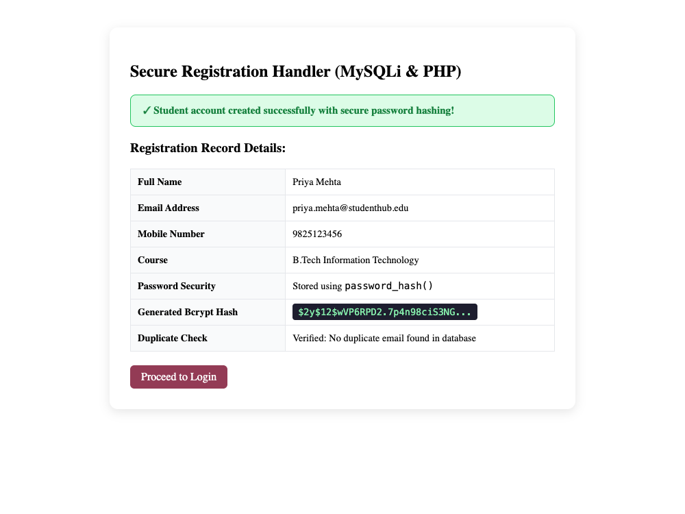
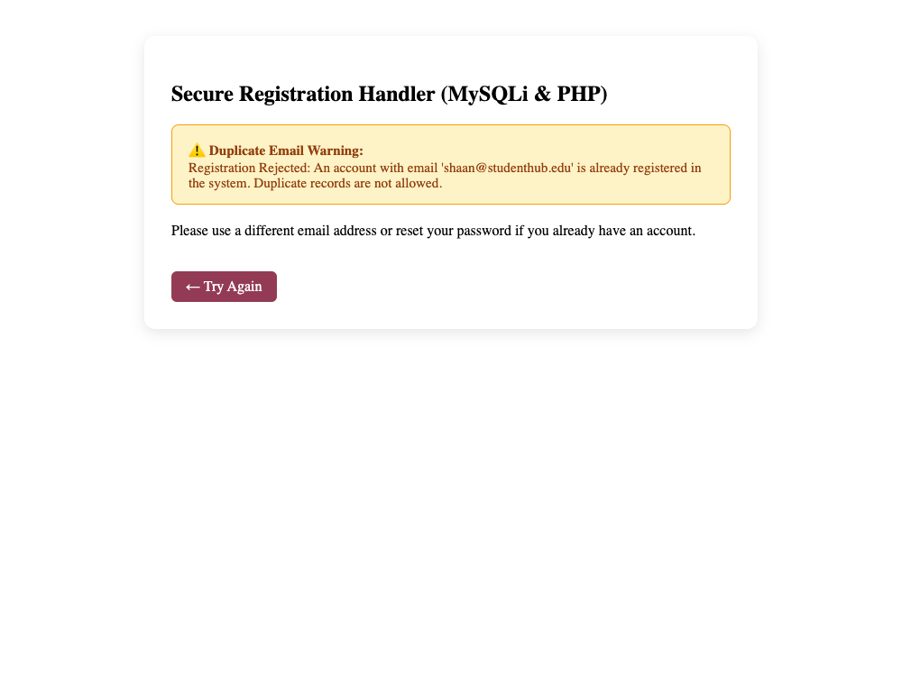

# Department of Computer Engineering

### **Practical - 9**

**Practical Title:** Secure User Registration with Database Insert, Duplicate Email Check, and Password Hashing  
**Problem Definition:** Implement secure user registration by inserting user details into MySQL using MYSQLi. Validate input on frontend and backend, check duplicate email/username, hash passwords using password_hash(), and display appropriate messages.

---

### **A. Theory**

#### **1. Is password_hash() used before storing passwords?**
**Answer:**  
Yes, `password_hash()` is used before storing passwords in the database. 

Passwords should never be stored in plain text because if the database is ever breached, all user accounts would be exposed:
- In PHP, we call `password_hash($password, PASSWORD_DEFAULT)`.
- This function uses the strong Bcrypt hashing algorithm by default.
- It automatically generates a unique, cryptographically random cryptographic salt for every password.
- Because a random salt is included, two users with the exact same password will have completely different hash strings in the database. This prevents attackers from using precomputed rainbow tables to crack passwords.
- During login, the password can be checked using `password_verify($inputPassword, $storedHash)`.

*Reference:* https://www.php.net/manual/en/function.password-hash.php and https://www.php.net/manual/en/function.password-verify.php

---

#### **2. Is duplicate email/username checked?**
**Answer:**  
Yes, duplicate email addresses are checked before inserting new records:
- Before running an insert query, the script runs a SELECT query with a prepared statement:  
  `SELECT student_id FROM students WHERE email = ?`
- If a record is found, registration stops immediately and a clear message is displayed: *"Registration Rejected: An account with this email is already registered in the system."*
- Additionally, in the MySQL database table, the `email` column is marked with a `UNIQUE` constraint. This acts as a second safeguard to ensure two users cannot have the same email even if multiple requests arrive at the same time.

*Reference:* https://dev.mysql.com/doc/refman/8.0/en/constraint-primary-key.html

---

#### **3. Are frontend and backend validations consistent?**
**Answer:**  
Yes, the frontend and backend validations use matching rules to ensure consistent data quality and security:
- Name field: Frontend checks min 3 alphabetic characters; backend checks `strlen($name) >= 3` and sanitizes with `trim()` and `htmlspecialchars()`.
- Email field: Frontend checks RFC format with regex; backend verifies using PHP's `filter_var($email, FILTER_VALIDATE_EMAIL)`.
- Mobile number: Frontend requires 10 digits starting with 6-9; backend checks the same using `preg_match("/^[6-9][0-9]{9}$/", $phone)`.
- Password field: Frontend requires at least 8 characters; backend enforces `strlen($password) >= 8`.
- Frontend validation provides immediate visual feedback to the student, while backend validation guarantees that data cannot be corrupted by someone submitting raw HTTP requests directly.

*Reference:* https://owasp.org/www-community/attacks/xss/ and https://web.dev/learn/forms/

---

### **B. Implementation / Output / Result**

In this practical, I created a secure user registration handler (`register_user.php`) using PHP and MySQLi:
- Received submitted registration data through HTTP POST.
- Sanitized and validated all input values on the server side.
- Checked for duplicate email addresses in the database using a MySQLi prepared statement (`SELECT student_id FROM students WHERE email = ?`).
- Hashed the user's password securely using PHP's built-in `password_hash()` function with Bcrypt.
- Prepared an SQL INSERT query using parameterized statements to prevent SQL Injection.
- Displayed user-friendly response messages: a green confirmation alert showing the registered details and hash preview on success, and a yellow warning when a duplicate email is detected.

---

### **C. Evidence of Work (Screenshots)**

#### **Figure 9.1: Successful User Registration with Password Hashing**
*Description: Shows the successful registration response card displaying user details, duplicate check verification, and a preview of the generated Bcrypt password hash ($2y$12$...).*

---

#### **Figure 9.2: Duplicate Email Detection and Error Alert**
*Description: Shows the duplicate email warning message displayed when attempting to register using an email address that already exists in the system.*

---

### **D. GitHub Repository Link:**
[https://github.com/shaandabhi1578/student-hub](https://github.com/shaandabhi1578/student-hub)

---

### **E. Challenges Faced:**
1. Storing hashed passwords securely: Plain text passwords or simple MD5 hashes are outdated and unsafe. I learned how to use PHP's modern `password_hash()` with `PASSWORD_DEFAULT` which uses Bcrypt.
2. Allocating sufficient column length in MySQL: A Bcrypt hash string is 60 characters long. If the database `password` column is too short (like `VARCHAR(32)`), the hash gets truncated and `password_verify()` fails. Setting the column to `VARCHAR(255)` resolved this issue.
3. Handling duplicate record messages gracefully: Without a preliminary SELECT query, duplicate insertions resulted in raw MySQL error codes. Adding the duplicate check beforehand provides a much friendlier user message.

---

### **F. Learning Outcomes:**
From this practical, I learned how to implement secure user authentication and database inserts:
- Why plain text passwords should never be stored and how to hash passwords with `password_hash()`.
- How to check for duplicate usernames or email addresses before inserting records.
- How to write parameterized INSERT queries in MySQLi using prepared statements.
- Why frontend and backend validation must be kept consistent for both usability and security.
- How to handle registration feedback with clear, actionable user messages.

---

### **Faculty Remarks:**
